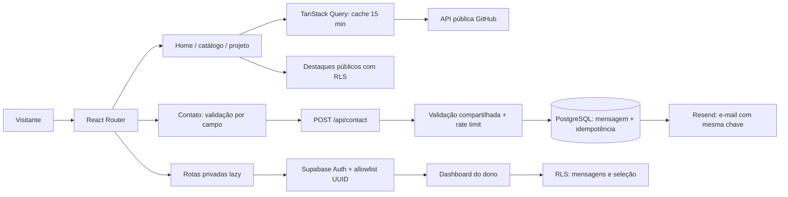
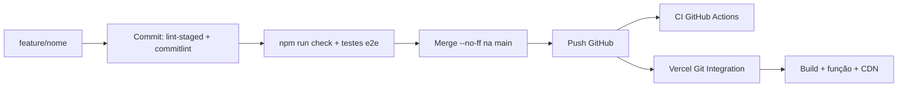

# Arquitetura e escolhas

## Responsabilidades e fluxo

`App` declara rotas e carregamento sob demanda. Componentes visuais recebem dados e callbacks. `useProjects` concentra os dois recursos remotos (GitHub e seleção de destaques); todos os consumidores compartilham a mesma chave de cache. Os estados de erro, vazio e skeleton são reutilizados no catálogo, nos detalhes e no voo. O serviço GitHub adapta o contrato externo e acrescenta os textos autorais quando existe correspondência de nome.

A navegação em voo herdada usa CSS e `requestAnimationFrame` somente durante scroll/resize, sem renderizar uma cena 3D ou manter loop permanente. Cenas inativas recebem `inert` e `aria-hidden`. O dono pode desabilitar os destaques; o visitante pode escolher modo leitura persistente, e o sistema respeita movimento reduzido. Em telas baixas, os conteúdos das cenas têm rolagem interna para manter formulário e erros alcançáveis.

O formulário tem bloqueio síncrono por ref, estado visual de envio e um UUID por tentativa lógica. Erro de rede mantém os valores e reutiliza a mesma chave. O servidor valida de novo, persiste antes de enviar e utiliza a mesma chave no Resend. Se a gravação falhar, não tenta o e-mail. Se somente o e-mail falhar, responde 202 e informa que a mensagem foi salva com notificação pendente. Não há garantia de processamento assíncrono automático para um e-mail pendente: ele deve ser acompanhado pelo dono, ou repetido com a mesma chave pelo cliente enquanto disponível.

A proteção tem duas camadas independentes: a rota impede mostrar a tela sem sessão verificada, e as políticas SQL impedem consultar/alterar dados com outra conta. `getUser` verifica a identidade junto ao servidor; `is_owner` consulta a allowlist de UUIDs. Não basta possuir um e-mail parecido nem alterar o localStorage. A service-role só existe na função HTTP.

## Alternativas, critérios e perdas

| Escolha                               | Alternativa comparada                     | Critério                                                              | Custo aceito                                                                          |
| ------------------------------------- | ----------------------------------------- | --------------------------------------------------------------------- | ------------------------------------------------------------------------------------- |
| React + Vite, preservando JSX         | Next.js / migração TypeScript             | Reaproveitar o site React existente, sem SSR necessário               | SEO de páginas individuais é limitado pelo SPA; sem tipagem estática neste incremento |
| React Router com BrowserRouter        | HashRouter / TanStack Router              | URLs limpas e compatibilidade com a base                              | Precisa de rewrite na hospedagem                                                      |
| TanStack Query                        | fetch em cada componente / SWR            | Mesmo cache entre rotas, invalidação e estados remotos                | Dependência adicional; cache em memória não sobrevive a reload                        |
| CSS e Tailwind herdados               | Biblioteca visual pronta                  | Manter identidade e interação autorais                                | Há CSS legado e sobreposições; futuras mudanças devem consolidar os tokens por escopo |
| Voo CSS sob demanda                   | Three.js / React Three Fiber              | Preservar assinatura visual com bundle leve                           | Profundidade simulada, sem geometria 3D real                                          |
| Supabase                              | Firebase / backend Express com PostgreSQL | SQL, Auth e autorização de dados por RLS no mesmo serviço             | Dependência de serviço externo e migração a executar                                  |
| Vercel Function + Resend              | EmailJS / Formspree                       | Gravar antes do envio, controlar validação e idempotência no servidor | Configuração de segredos, remetente e tratamento da entrega parcial                   |
| Context local + storage               | Redux / Zustand                           | Dois estados simples de preferência                                   | Persistência é por navegador, não por conta                                           |
| Vitest + Testing Library + Playwright | Somente testes manuais                    | Regras rápidas e fluxos reais no navegador                            | Mais ferramentas e manutenção de fixtures; mocks não comprovam serviços reais         |
| GitHub Flow + merge --no-ff           | Git Flow / commits diretos em main        | Branch por entrega, contexto de integração visível                    | Histórico mais extenso; deploy Vercel nativo não espera o CI por padrão               |

## Da alteração ao deploy

A integração Vercel publica cada push de `main` e previews das branches. O CI e o deploy nativo rodam em paralelo; habilite os mecanismos de checks da Vercel/branch protection se quiser bloquear publicação por falha do CI. Nesta sessão, os checks locais precedem a integração.

## Fontes técnicas

- [Vite na Vercel: deep linking de SPA](https://vercel.com/docs/frameworks/frontend/vite).
- [Supabase: Row Level Security](https://supabase.com/docs/guides/database/postgres/row-level-security).
- [Supabase: getUser](https://supabase.com/docs/reference/javascript/auth-getuser).
- [Resend: idempotência](https://resend.com/docs/dashboard/emails/idempotency-keys).
- [TanStack Query: defaults de cache](https://tanstack.com/query/latest/docs/framework/react/guides/important-defaults).

As escolhas acima são critérios desta implementação; não implicam que uma ferramenta seja superior em todos os contextos.
